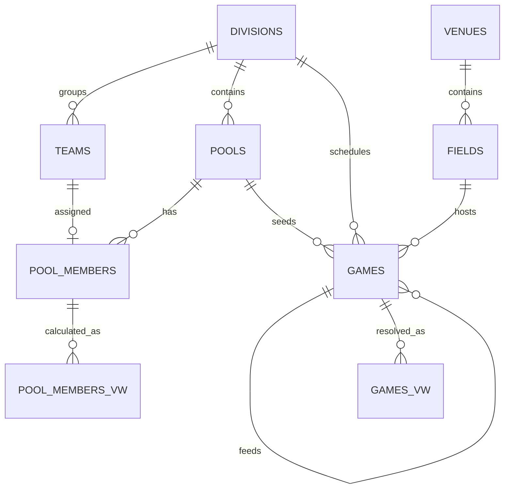

# Tournament tracker

A Streamlit app for tournament information, schedules, pool assignments, and
administrative data entry. Visitors can browse without logging in. Signed-in
administrators can manage tournament data.

## Run the app

```powershell
python -m pip install -r requirements.txt
python -m streamlit run app.py
```

Google sign-in and administrator access are described in
[AUTHENTICATION.md](AUTHENTICATION.md). Public visitors do not need an account.

## Data design: entered tables and calculated views

The database separates facts an administrator enters from values derived from
those facts. Entered values live in tables. SQL views calculate standings and
resolved participants; those calculated values are read-only and are never
manually keyed in.



### Entered tables

- `divisions`: division name and its associated tournament name.
- `teams`: team name, division, city/state, payment received date, payment
  channel (PayPal, Venmo, Zelle, or Check), payment amount, and optional
  future-use access PIN.
- `pools`: named pools within a division.
- `pool_members`: one row per pool slot, with `pool_id`, numbered `position`,
  and an optional `team_id` until a team is assigned. Creating a pool with a
  member count creates that many empty slots. A team can occupy only one pool
  slot at a time.
- `venues`: venue name and address or URL.
- `fields`: named playing areas at a venue. Games select a field, so multiple
  games can be scheduled at the same venue at the same time on different fields.
- `games`: one row per game. Schedule fields, status, scores, and each side's
  source rule are entered here. Side A/B source rules can be a fixed team, a
  final standings rank, an initial pool entry position, another game's
  winner/loser, or unresolved. For example, a
  semifinal can use Pool A rank 1 and Pool D rank 1; a later game can use the
  winner of each semifinal.

### Calculated views

`pool_members_vw` adds wins, losses, goals for, goals against, goal
differential, and `final_rank` to pool assignments. `final_rank` uses `ROW_NUMBER`
ordered by wins descending, losses ascending, goal differential descending, and
pool entry position ascending, so each assigned team receives a unique place.
Ranks are populated independently for each pool only after that pool has at
least one Pool-stage game and every such game is Final with both scores entered.
An unfinished game in Pool A does not prevent Pool B from being ranked. Games
count toward standings when they are Final, are marked as Pool stage, and have a fixed-team source.
If those criteria or later tie-break rules change, update the view definition;
do not hand-enter these statistics.

`games_vw` adds resolved `team_a_id` and `team_b_id`, plus `winner_team_id` and
`loser_team_id`. It resolves fixed-team sources directly, pool-rank sources
through `pool_members_vw`, pool-entry sources through `pool_members.position`,
and winner/loser sources from completed games. A tie
has no calculated winner or loser until a tie-break result is represented.
Correcting an earlier score automatically changes dependent resolved teams
because the view recalculates from the entered source rules and results.

The views are derived on query; the app writes only to the base tables. The
Admin page's **Calculated views** tab shows the current computed values.

In the data manager, **Divisions** comes first and records a division name and
tournament name. **Pools** comes next; creating a pool with a member count
creates numbered empty `pool_members` slots. The **Pool members** tab assigns
teams to those slots after choosing a division and then a pool. The **Teams**
tab filters the spreadsheet editor to one selected division at a time. Related
records are selected by readable names and codes;
database IDs are internal keys and are hidden from routine entry screens.

Administrators also have a separate **Score entry** page. It filters games by
division, status, and stage, then presents scores and status in a chronological
editable worksheet. Shared top navigation links back to Home and between
division pages; favorite-team games receive a highlighted row on the schedule.

## Current limits and rules to confirm

- Pool ranking orders by wins descending, losses ascending, goal differential
  descending, and entry position ascending. Head-to-head and other tie-breakers
  are not implemented.
- Only final Pool-stage games with fixed team sources contribute to pool stats.
- A tied final game has no winner/loser; add an explicit advancement rule or
  tie-break score field if the tournament permits ties in elimination games.
- Pool `position` is an entered slot number, distinct from calculated
  `final_rank`. Playoff seeds should reference the calculated rank.
- The admin grids display related divisions, pools, teams, venues, and games
  by name/code; IDs remain internal database keys.

## Other app configuration

`config.yaml` contains presentation details and public division navigation.
Database divisions should stay aligned with that config. Home-page venue cards
also come from YAML today, while game scheduling uses `venues` in SQLite.

`database_setup.sql` defines the schema and views. `database.py` initializes
them and applies migrations, including conversion of the former
`matches`/`match_sides` model into `games`, `pool_teams` into numbered
`pool_members` slots, divisions to include tournament names, and venues to
support multiple fields.

## Code map

- `app.py`: public navigation and administrator-only page registration.
- `app_pages/`: home and division pages.
- `admin.py`: entered-table editors and calculated-view inspection.
- `app_pages/scores.py`: division-filtered bulk score and status entry.
- `division_view.py`: public schedule and standings pages.
- `database.py`: schema initialization and migrations.
- `database_setup.sql`: entered tables and calculated SQL views.
- `tournament_auth.py`: optional login and admin authorization.
